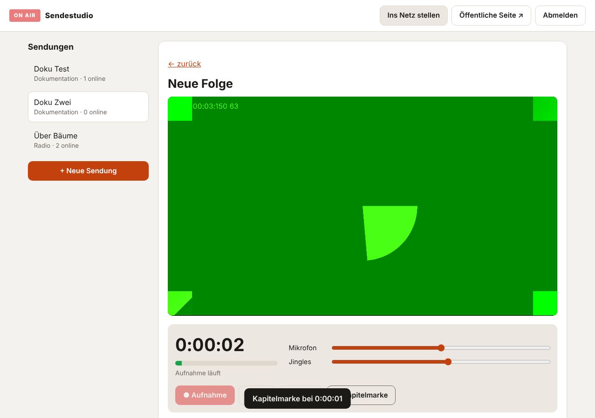

# Sendestudio

Podcasts, Radio und Dokumentationen im Browser aufnehmen und direkt ins Netz
stellen. Ein Programm, ein Befehl, keine fremden Pakete – nur Python 3.9+.
ffmpeg ist optional und macht die Aufnahmen podcast-tauglich.



### Klickbare Demo

[`docs/sendestudio-demo.html`](docs/sendestudio-demo.html) – eine einzelne Datei,
herunterladen und im Browser öffnen, ohne Installation. Sie zeigt Aufnahme mit
Hintergrundmusik, Jingles und Kapitelmarken, eine Beispiel-Dokumentation, KI-Knöpfe, verschlüsselte Entwürfe, die öffentliche
Seite mit Live-Radio und den Podcast-Feed. Alles bleibt im Browser; die
KI-Antworten sind dort Beispiele. Über GitHub Pages erscheint sie unter
`https://levirob2015.github.io/L-vi/sendestudio.html`.

## Was es kann

**Aufnehmen**
- Mikrofon, Kamera + Mikrofon oder Bildschirm + Mikrofon – direkt im Browser
- Pegelanzeige, Lautstärkeregler, Pause, Uhr
- **Jingle-Pads**: sechs Tasten für Jingles, Intros und Einspieler, die live in die Aufnahme gemischt werden
- **Kapitelmarken** per Knopfdruck während der Aufnahme
- **Hintergrundmusik**, die automatisch leiser wird, sobald gesprochen wird – wie im Radio
- Oder eine fertige Datei hochladen (MP3, M4A, MP4, WebM, Ogg, WAV)

**Verwalten**
- Sendungen in drei Arten: **Podcast**, **Radio**, **Dokumentation**
- Cover, Beschreibung, Shownotes, Kapitel bearbeiten
- Entwürfe, die niemand sieht, bis du sie veröffentlichst – und die bis dahin
  **nur verschlüsselt** auf dem Server liegen (siehe [Sicherheit](#sicherheit))

**Musik**
- **Musikbibliothek** mit Titel, Künstler, Lizenz und Quelle jedes Stücks
- Hintergrundmusik schon bei der Aufnahme – oder nachträglich **unter eine fertige Folge legen** (mit automatischem Leiserwerden beim Sprechen)
- Jingle-Tasten direkt aus der Bibliothek belegen
- **Musik-Angaben** erscheinen öffentlich an der Folge und im Feed (verlangen viele freie Lizenzen)
- **KI-Musik** nach Beschreibung (optional, ElevenLabs)

**Mit KI erstellen** (optional, siehe [KI-Werkzeuge](#ki-werkzeuge))
- **Texte:** Shownotes, Titelvorschläge, Kapitel, Sendungsbeschreibung, Social-Media-Post, ganze Sprechskripte
- **Aus der Aufnahme:** abschreiben lassen → Shownotes, Kapitel mit Zeitmarken und Titelvorschläge
- **Bilder:** Cover per Beschreibung malen lassen
- **KI-Stimme:** Text oder Skript als fertige Folge vorlesen lassen
- **Videos:** aus einem Thema ein ganzes Erklär-/Doku-Video (Szenen mit KI-Bildern und KI-Stimme), oder aus einer Aufnahme + Cover ein Video für YouTube & Co.
- Alles KI-Erzeugte wird ein Entwurf und ist öffentlich **als KI-generiert gekennzeichnet**

**Ins Netz stellen**
- Öffentliche Seite mit Player, Kapiteln und Download – auch auf dem Handy
- **Podcast-Feed** (RSS mit iTunes- und Kapitel-Angaben) für Apple Podcasts, Spotify, AntennaPod & Co.
- **Radio rund um die Uhr**: Die Folgen einer Radio-Sendung laufen als Endlosprogramm nach der Uhrzeit. Wer einschaltet, hört dieselbe Stelle wie alle anderen – ohne Streaming-Server.
- Auf drei Wegen online: der Studio-Server selbst, als **statische Seite** für jeden Webspace (GitHub Pages, Netlify …) oder per **FTP/FTPS** direkt auf deinen Webspace

Mit ffmpeg werden Aufnahmen automatisch in MP3 (Ton) bzw. MP4 (Video)
umgewandelt, auf Wunsch auf Podcast-Lautstärke (−16 LUFS) angeglichen und
exakt vermessen. Ohne ffmpeg bleibt die Datei, wie sie ist.

## Schnellstart

```bash
git clone https://github.com/Levirob2015/L-vi.git
cd L-vi
pip install -e .                    # oder: export PYTHONPATH=$PWD

sendestudio init --titel "Mein Sender"
# -> zeigt Studio-Passwort und Wiederherstellungsschlüssel an - beides gut aufheben

sendestudio zweifaktor              # empfohlen: Anmeldung zusätzlich mit Code vom Handy

sendestudio serve
# Studio:            http://127.0.0.1:8790/studio
# Öffentliche Seite: http://127.0.0.1:8790/
```

Im Studio:

1. **+ Neue Sendung** – Titel, Art (Podcast / Radio / Dokumentation), Beschreibung, danach ein Cover.
2. **● Neue Folge aufnehmen** – Quelle wählen, *Studio einschalten*, *Aufnahme*. Jingles laden und antippen, mit *⚑ Kapitelmarke* Abschnitte markieren, *■ Stopp*.
3. Anhören, Titel und Shownotes eintragen, **Speichern & veröffentlichen**.

Die Folge ist sofort auf der öffentlichen Seite und im Feed.

## Wirklich ins Netz

### Weg 1: Das Studio läuft auf einem Server

Dann ist alles, was du veröffentlichst, sofort online. Auf einem Server
(z.B. ein kleiner VPS) mit eigener Domain:

```bash
sudo python3 -m venv /opt/sendestudio
sudo /opt/sendestudio/bin/pip install "git+https://github.com/Levirob2015/L-vi"
sudo apt install ffmpeg                       # empfohlen
sudo mkdir -p /var/lib/sendestudio && cd /var/lib/sendestudio
sudo /opt/sendestudio/bin/sendestudio init --titel "Mein Sender" \
     --basis-url https://radio.example.de
sudo cp deploy/sendestudio.service /etc/systemd/system/
sudo systemctl daemon-reload && sudo systemctl enable --now sendestudio
```

Davor gehört ein Webserver mit HTTPS. **Ohne HTTPS erlaubt kein Browser
den Zugriff auf Mikrofon und Kamera** (Ausnahme: `localhost`). Am
einfachsten mit [Caddy](https://caddyserver.com), das sich das Zertifikat
selbst holt – `/etc/caddy/Caddyfile`:

```
radio.example.de {
    request_body {
        max_size 4GB
    }
    reverse_proxy 127.0.0.1:8790
}
```

Danach in `sendestudio.json` setzen und den Dienst neu starten:

```json
"sicheres_cookie": true,
"vertraute_proxys": ["127.0.0.1"]
```

`vertraute_proxys` sorgt dafür, dass der Login-Schutz die echte Adresse
des Besuchers sieht und nicht die von Caddy.

### Weg 2: Statische Seite auf beliebigen Webspace

Das Studio läuft bei dir zu Hause, veröffentlicht wird eine fertige
Webseite:

```bash
sendestudio export               # schreibt nach ./oeffentlich
```

oder im Studio *Ins Netz stellen → Statische Seite erzeugen*. Den Ordner
lädst du auf deinen Webspace, zu GitHub Pages oder Netlify. Wichtig:
`basis_url` in `sendestudio.json` auf die spätere Adresse setzen, sonst gibt
es keinen Podcast-Feed – Podcast-Apps brauchen vollständige Adressen.

Der Export räumt hinter sich auf: Ziehst du eine Folge zurück,
verschwindet sie beim nächsten Export auch aus dem Ordner. Dateien, die
nicht vom Export stammen, bleiben unangetastet.

### Weg 3: Per FTP direkt auf den Webspace

In `sendestudio.json`:

```json
"basis_url": "https://www.mein-webspace.de/podcast",
"ftp": {
  "host": "ftp.mein-webspace.de",
  "benutzer": "web123",
  "passwort": "…",
  "pfad": "/podcast",
  "port": 21,
  "tls": true
}
```

Dann `sendestudio ftp` oder im Studio *Ins Netz stellen → Per FTP
hochladen*. Verschlüsselt (FTPS) ist Standard. Audio-Dateien, die schon
oben liegen, werden übersprungen.

## Den Podcast bei Apple, Spotify & Co. anmelden

Die Feed-Adresse steht auf der Seite deiner Sendung und im Studio unter
*Ins Netz stellen*, z.B. `https://radio.example.de/s/mein-podcast/feed.xml`.
Diese Adresse reichst du einmal ein:

- Apple Podcasts: [podcastsconnect.apple.com](https://podcastsconnect.apple.com)
- Spotify: [podcasters.spotify.com](https://podcasters.spotify.com)
- Alle anderen Apps: *Podcast per URL hinzufügen*

Neue Folgen erscheinen danach automatisch. Apple verlangt ein Cover von
mindestens 1400 × 1400 Pixeln.

## Einstellungen (`sendestudio.json`)

| Schlüssel | Bedeutung |
|---|---|
| `seitentitel` | Name der öffentlichen Seite |
| `basis_url` | Öffentliche Adresse – nötig für den Feed |
| `host`, `port` | Wo der Server lauscht (Standard `127.0.0.1:8790`) |
| `daten` | Ordner für Datenbank und Aufnahmen |
| `export_ziel` | Ordner für den statischen Export |
| `max_upload_mb` | Größte erlaubte Datei (Standard 4096) |
| `sicheres_cookie` | Anmeldung nur über HTTPS – einschalten, sobald HTTPS läuft |
| `vertraute_proxys` | Proxys, deren `X-Forwarded-For` geglaubt wird |
| `studio_netze` | Studio nur aus diesen Netzen erreichbar, z.B. `["192.168.0.0/16"]` – leer = überall |
| `leerlauf_minuten` | Automatische Abmeldung nach so viel Untätigkeit (Standard 60) |
| `totp_geheimnis` | Nicht von Hand ändern – `sendestudio zweifaktor` benutzen |
| `ftp` | Zugang für Weg 3 |
| `passwort_hash` | Nicht von Hand ändern – `sendestudio passwort` benutzen |

Die Datei wird nur für ihren Besitzer lesbar angelegt (sie enthält ggf. das
FTP-Passwort).

## Musik

### Welche Musik darf ich verwenden?

Nur Musik, an der du die Rechte hast:

- **selbst gemacht** – gehört dir;
- **frei lizenziert** – z. B. CC0 (gemeinfrei) oder CC BY (dann Urheber nennen). Quellen: Pixabay Music, Free Music Archive, YouTube Audio Library. Die Lizenz jedes einzelnen Stücks prüfen;
- **gekauft mit Lizenz** für Podcasts/Streaming („GEMA-frei“);
- **KI-Musik** – die Nutzungsrechte regeln die Bedingungen des Anbieters bzw. deines Tarifs.

**Songs aus Spotify, Apple Music oder YouTube gehen nicht.** Sie sind
kopiergeschützt und lassen sich nicht in eigene Aufnahmen übernehmen, und
das Abo erlaubt nur privates Hören. Wer bekannte Songs in einem öffentlichen
Podcast oder Webradio spielt, braucht in Deutschland Lizenzen von GEMA (und
für Webradio zusätzlich GVL) – sonst drohen Abmahnungen, und Plattformen
nehmen solche Folgen oft wieder herunter.

### So geht's

- **🎵 Musikbibliothek** (links in der Seitenleiste): Stück hochladen und
  Titel, Künstler, Lizenz und Quelle eintragen. Stücke der Bibliothek liegen
  verschlüsselt im Tresor – öffentlich wird nur, was in einer
  veröffentlichten Folge zu hören ist.
- **Bei der Aufnahme**: unter „Hintergrundmusik“ ein Stück wählen,
  „Musik starten“. Mit „Automatisch leiser beim Sprechen“ regelt das Studio
  die Musik herunter, sobald du sprichst, und in Pausen wieder hoch. Die
  Jingle-Tasten lassen sich ebenfalls aus der Bibliothek belegen.
- **Nachträglich**: Folge bearbeiten → „🎵 Musik unterlegen“. Die Musik läuft
  in Schleife unter der ganzen Aufnahme, blendet am Anfang ein und am Ende
  aus, und wird beim Sprechen leiser (Sidechain-Kompression, etwa −12 dB).
  Es entsteht ein neuer Entwurf, das Original bleibt. Braucht ffmpeg.
- **Musik-Angaben**: Jedes eingesetzte Stück aus der Bibliothek wird
  automatisch unter „Verwendete Musik“ eingetragen; eigene Angaben lassen
  sich ergänzen. Öffentlich steht dann an der Folge „Musik: Titel – Künstler
  (Lizenz)“ mit Link zur Quelle, und dasselbe im Feed.
- **✨ KI-Musik** (in der Musikbibliothek): beschreiben, wie es klingen soll,
  Länge wählen (3 Sekunden bis 10 Minuten), auf Wunsch nur instrumental. Das
  Stück landet in der Bibliothek und wird bei Verwendung als
  „KI-generiert: Musik“ gekennzeichnet. Braucht einen ElevenLabs-Schlüssel
  (`ELEVENLABS_API_KEY`).

## KI-Werkzeuge

Im Studio erscheinen die KI-Knöpfe (✨), sobald die Zugänge eingerichtet
sind. Sie sind ganz freiwillig: Ohne Schlüssel läuft das Studio wie bisher.

| Was | Anbieter | Was du brauchst |
|---|---|---|
| Texte (Shownotes, Titel, Kapitel, Skripte …) | Claude von Anthropic | `ANTHROPIC_API_KEY` und `pip install "sendestudio[ki]"` (Python 3.10+) |
| Bilder, KI-Stimme, Transkription | OpenAI (oder kompatibel) | `OPENAI_API_KEY` |
| Musik | ElevenLabs („Eleven Music“) | `ELEVENLABS_API_KEY` |
| Videos | wird im Studio aus KI-Bildern und KI-Stimme geschnitten | zusätzlich ffmpeg |

Die Schlüssel am besten als Umgebungsvariablen setzen, z. B. in der
systemd-Unit:

```ini
[Service]
Environment=ANTHROPIC_API_KEY=sk-ant-…
Environment=OPENAI_API_KEY=sk-…
Environment=ELEVENLABS_API_KEY=…
```

Alternativ in `sendestudio.json` unter `"ki"` (die Datei ist nur für den
Besitzer lesbar):

```json
"ki": {
  "anthropic_schluessel": "",
  "text_modell": "claude-opus-5-5",
  "openai_schluessel": "",
  "openai_url": "https://api.openai.com/v1",
  "bild_modell": "gpt-image-2",
  "stimme_modell": "gpt-4o-mini-tts",
  "stimme": "coral",
  "transkript_modell": "whisper-1",
  "elevenlabs_schluessel": "",
  "musik_url": "https://api.elevenlabs.io/v1",
  "musik_modell": "",
  "tageslimit": 50
}
```

**So geht's im Studio:**
- **Folge bearbeiten → „✨ Aus der Aufnahme“** schreibt die Aufnahme ab und
  schlägt Shownotes, Kapitel und Titel vor. Nichts wird ungefragt
  überschrieben, du prüfst und speicherst.
- **Sendung → Einstellungen → „✨ Cover erzeugen“** malt ein Cover nach
  deiner Beschreibung („Idee vorschlagen“ hilft beim Formulieren). Mit ffmpeg
  wird es auf die von Apple verlangten 1400 Pixel gebracht.
- **Sendung → „✨ KI-Studio“:** Thema eingeben, Skript schreiben lassen,
  nach Belieben ändern, dann „Mit KI-Stimme vertonen“ – fertig ist eine
  neue Folge. Oder „KI-Video“: Claude plant die Szenen, für jede entsteht
  ein Bild und ein gesprochener Text, das Studio schneidet alles zusammen.
- **Folge bearbeiten → „🎬 Video daraus machen“:** Aufnahme + Cover + bewegte
  Wellenform als MP4.

KI-Aufträge laufen im Hintergrund, der Fortschritt steht unten rechts. Du
kannst derweil weiterarbeiten.

**Kennzeichnung:** Seit August 2026 verlangt die EU-KI-Verordnung (Art. 50),
dass KI-erzeugte Inhalte als solche erkennbar sind. Das Studio setzt die
Angaben „KI-Anteile: Text / Stimme / Bilder / Musik / Video“ automatisch, wenn du ein
KI-Werkzeug benutzt. Du kannst sie in jeder Folge anpassen. Öffentlich
erscheint dann „KI-generiert: …“ an der Folge und ein Hinweis im Feed.
Verantwortlich für das Veröffentlichte bleibst du – also bitte prüfen, was
die KI geschrieben hat, besonders Fakten und Namen.

**Was das kostet und was es verrät:**
- Jeder Aufruf eines Anbieters kostet dort Geld. `ki.tageslimit` begrenzt die
  Zahl der Aufrufe pro Tag (Standard 50). Ein KI-Video mit 8 Szenen braucht
  17 Aufrufe (1× Planung, je Szene 1× Bild und 1× Stimme). Mit
  `"tageslimit": 0` ist die KI ganz aus.
- **Was du einem KI-Werkzeug gibst, verlässt deinen Server** und geht an
  Anthropic, OpenAI bzw. ElevenLabs – bei „Aus der Aufnahme“ die ganze Aufnahme. Das
  passiert nur auf Knopfdruck, nie automatisch. Für streng vertrauliche
  Entwürfe die KI-Knöpfe einfach nicht benutzen.
- Bei Claude ist der eingebaute Ausweichweg der API eingeschaltet: Lehnt
  ein Sicherheitsfilter eine Anfrage ab, beantwortet sie automatisch ein
  anderes Claude-Modell.
- Es werden keine Stimmen geklont und keine echten Personen nachgebildet. Die
  KI-Stimmen sind die eingebauten Stimmen des Anbieters.

Warum kein „echter“ KI-Videogenerator? OpenAIs Video-Schnittstelle (Sora) ist
in deren offizieller API-Beschreibung als veraltet markiert – darauf soll
kein neues Programm bauen. Die Videos aus KI-Bildern und KI-Stimme laufen
dagegen mit jedem Bild- und Sprachdienst.

## Sicherheit

### Deine Daten bleiben deine, bis du veröffentlichst

Alles, was noch nicht öffentlich ist, liegt **nur verschlüsselt** auf dem
Server: die Aufnahmen von Entwürfen und zurückgezogenen Folgen, deren Titel,
Beschreibungen und Kapitel sowie das Cover einer Sendung, solange sie noch
keine veröffentlichte Folge hat. Auch die Dateinamen sind zufällig und
verraten nichts über den Inhalt.

- **Erst beim Veröffentlichen** entsteht die lesbare Datei. Ziehst du eine
  Folge zurück, wandert sie sofort wieder in den Tresor.
- **Der Schlüssel liegt nirgends offen.** Er ist mit deinem Passwort
  verschlossen. Der Server kennt ihn nur, solange du angemeldet bist. Nach
  dem Abmelden, nach `leerlauf_minuten` ohne Aktivität oder nach einem
  Neustart vergisst er ihn wieder.
- Wer die Festplatte, ein Backup oder den Server in die Hände bekommt, sieht
  von deinen Entwürfen **nur Datenmüll**. (Wer allerdings dauerhaft die
  Kontrolle über den Server hat, könnte das Programm verändern und dein
  Passwort bei der nächsten Anmeldung mitschneiden – vor einem bösartigen
  Server-Betreiber schützt keine Software, die auf diesem Server läuft.)
- **Manipulation fällt auf:** Jeder Block ist mit einer Prüfsumme
  gesichert. Wer etwas verändert oder abschneidet, wird bemerkt.
- **Wiederherstellungsschlüssel:** `sendestudio init` zeigt ihn einmal an.
  Mit ihm setzt du ein neues Passwort, falls du es vergessen hast
  (`sendestudio passwort`). **Ohne Passwort und ohne diesen Schlüssel sind
  unveröffentlichte Aufnahmen verloren** – das ist der Preis echter
  Verschlüsselung. Also ausdrucken oder offline aufheben.

Verfahren (nur Bausteine aus Pythons Standardbibliothek):
Schlüsselableitung mit PBKDF2-HMAC-SHA256 (310 000 Runden), Verschlüsselung
mit SHAKE-256 als Schlüsselstrom, Integrität mit HMAC-SHA256 je 1-MiB-Block
(Encrypt-then-MAC, mit Blocknummer und Ende-Kennzeichen).

Was der Tresor **nicht** abdeckt, ehrlich gesagt:
- Name und Beschreibung einer **Sendung** (nicht der Folgen) sowie Titel und
  Künstler der Stücke in der Musikbibliothek stehen im Klartext in der
  Datenbank – die Datenbank ist nur für den Besitzer lesbar. Die
  Musikdateien selbst liegen verschlüsselt.
- Während eine Aufnahme hochgeladen und umgewandelt wird, liegt sie für
  diesen Moment unverschlüsselt im Datenordner. Gelöschte Daten können auf
  SSDs physisch noch eine Weile vorhanden sein.
- Läuft beim Abmelden noch ein KI-Auftrag, wird sein Ergebnis erst bei der
  nächsten Anmeldung verschlüsselt.
- Wer den laufenden Server übernimmt, **während** du angemeldet bist, kommt
  an den Schlüssel im Arbeitsspeicher. Deshalb alles Folgende.

### Schwer zu knacken

- **Zwei-Faktor-Anmeldung** (`sendestudio zweifaktor`): Zum Passwort gehört
  ein Code aus einer Authenticator-App. Jeder Code gilt nur einmal – ein
  mitgelesener nützt nichts.
- **Login-Schutz durch LoginShield** aus diesem Repository: Nach mehreren
  Fehlversuchen wird die Adresse gesperrt, mit jedem Mal länger.
- **Studio nur aus bestimmten Netzen** (`studio_netze`): Für alle anderen
  gibt es das Studio gar nicht. Sie sehen nur die öffentliche Seite.
- **Automatische Abmeldung** nach Untätigkeit, im Browser und auf dem
  Server. Danach wird auch der Bildschirm geleert.
- Passwort nur als PBKDF2-Hash gespeichert. Sitzung als `HttpOnly`- und
  `SameSite=Strict`-Cookie, mit HTTPS als `__Host-`-Cookie plus HSTS.
  Gegen CSRF braucht zusätzlich jede ändernde Anfrage eine Pflicht-Kennung.
- Hochgeladene Dateien werden **am Inhalt** erkannt, nicht am Namen. ffmpeg
  darf beim Umwandeln nur die eine lokale Datei lesen – präparierte
  Mediendateien können keine Netzwerkanfragen auslösen oder andere Dateien
  nachladen.
- Strenge Content-Security-Policy ohne Inline-Skripte, Schutz gegen
  Einbetten in fremde Seiten (Clickjacking), keine Versionsnummern nach
  außen. Vor der Anmeldung verrät die Schnittstelle nichts über den Server.
- Gegen Überlastung: Verbindungen ohne Daten fliegen nach 60 Sekunden raus,
  höchstens 256 Verbindungen gleichzeitig, Anfragen mit `Transfer-Encoding`
  (Request Smuggling) werden abgelehnt.
- Konfiguration, Schlüsseldatei und Datenordner sind nur für den Besitzer
  lesbar.

**Empfehlung für den Betrieb im Netz:** HTTPS (siehe oben),
`"sicheres_cookie": true`, Zwei-Faktor-Anmeldung einschalten – und wenn du
nur von zu Hause aufnimmst, `studio_netze` auf dein Heimnetz bzw. VPN setzen.

## Befehle

```
sendestudio init [--titel T] [--basis-url URL]   Konfiguration + Passwort anlegen
sendestudio passwort [--zufall]                 Neues Passwort (fragt altes oder Wiederherstellungsschlüssel)
sendestudio zweifaktor [--aus]                  Zwei-Faktor-Anmeldung ein-/ausschalten
sendestudio serve [--host H] [--port P]         Studio + öffentliche Seite starten
sendestudio export [ZIEL]                       Statische Seite schreiben
sendestudio ftp                                 Exportieren und per FTP hochladen
```

## Tests

```bash
python -m pytest tests/test_sendestudio.py tests/test_sendestudio_sicherheit.py tests/test_sendestudio_ki.py -q
```

Die Tests laufen mit und ohne ffmpeg. Die KI-Tests rufen keinen echten
Anbieter auf (und kosten nichts): Sie laufen gegen nachgebaute Anthropic- und
OpenAI-Server, die genau prüfen, was das Studio ihnen schickt.
